# Roads & Runes

A real-world cycling exploration RPG. The map is the real world, your bicycle
is how you explore it. iPhone + Apple Watch client in Swift; Python/FastAPI
backend on PostgreSQL/PostGIS with GraphHopper and Valhalla routing.

> "There's a quest over there, and I've never ridden through that area."

Every road was written once, by people who cut a rune where two ways met.
Nobody reads them any more, and a road that is used and not read goes vague:
that is the fog. You ride to read it. New ground lifts the fog, quests send you
somewhere you have not been, creatures settle where nobody is paying attention
and your effort near them sees them off, and every journey ends in a reckoning
of what it earned. Rides, runs and walks all count. The world is in
[docs/WORLD.md](docs/WORLD.md).

## Screens

Version 0.9.2 on the iPhone 17 Pro simulator, played by a new Explorer in
Rotherhithe against the local backend, from choosing a class to the first
journey's entry in the Journal.

| Choose your class | World | Quests | Quest detail |
|---|---|---|---|
| 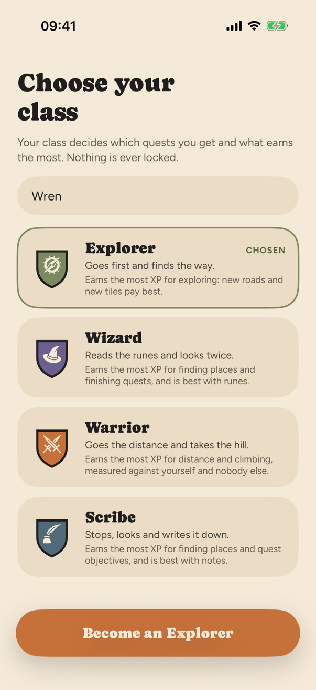 | 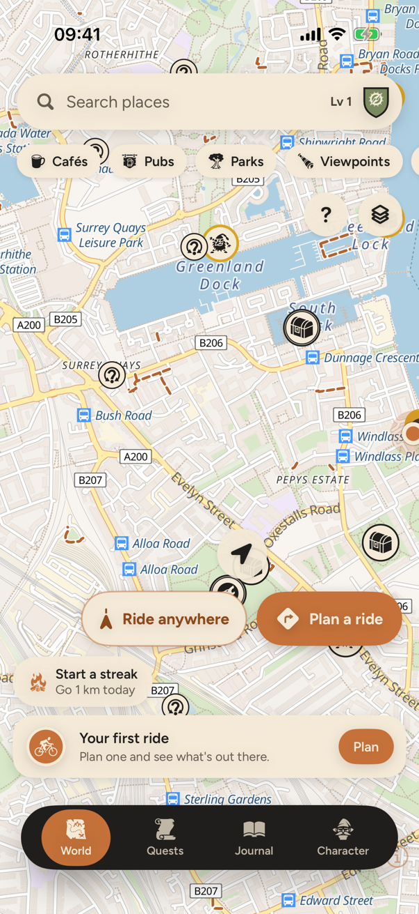 | 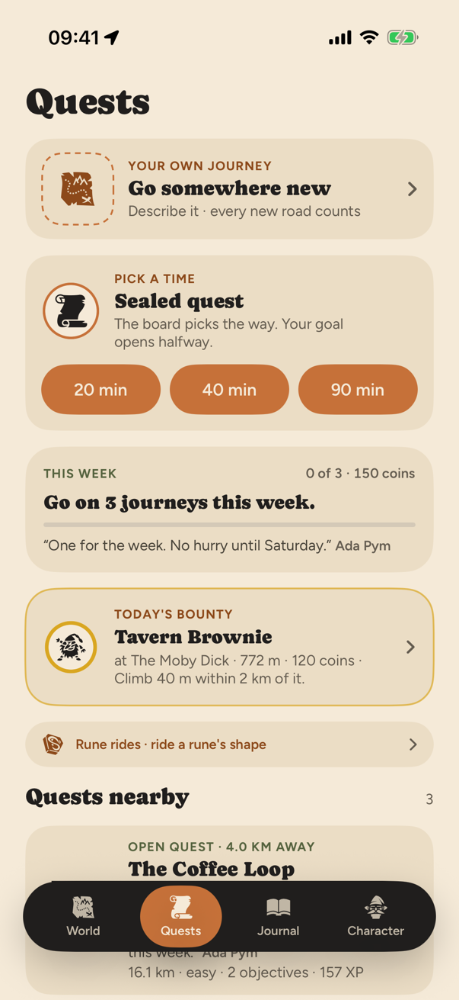 | 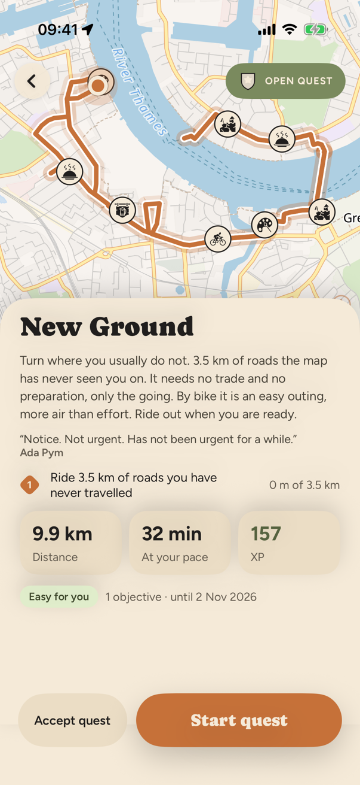 |

| Quest route | On the ride | Journey's end | Journal |
|---|---|---|---|
| 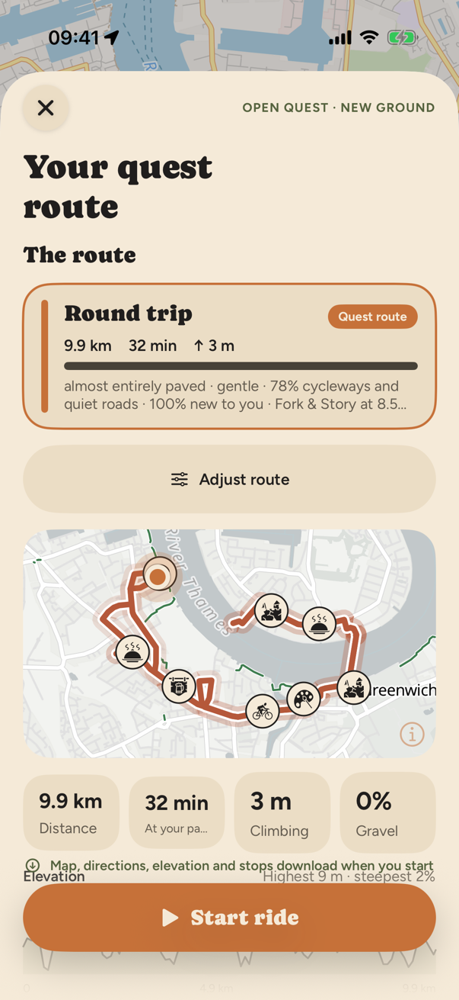 | 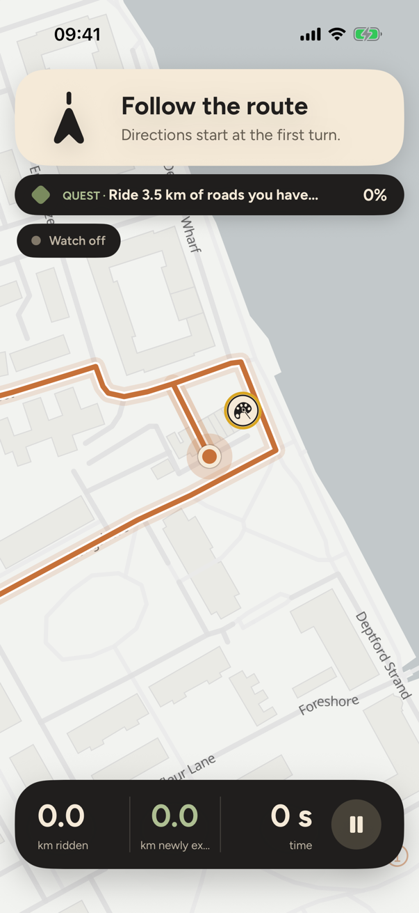 | 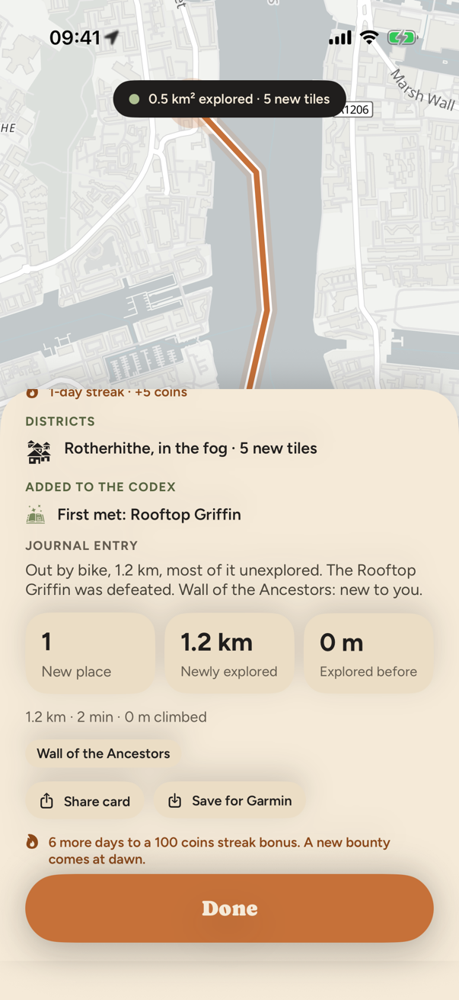 | 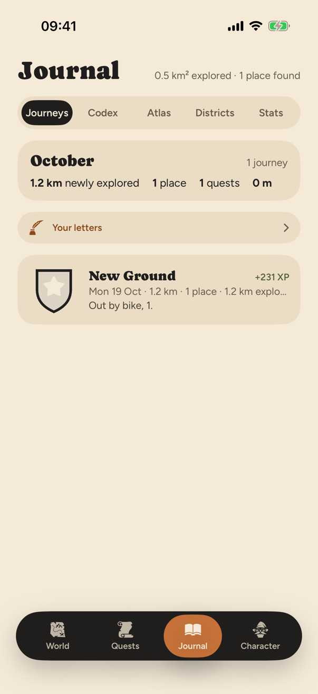 |

| Character | Ride anywhere (0.9.2) | Apple Watch: navigation | Apple Watch: quest |
|---|---|---|---|
| 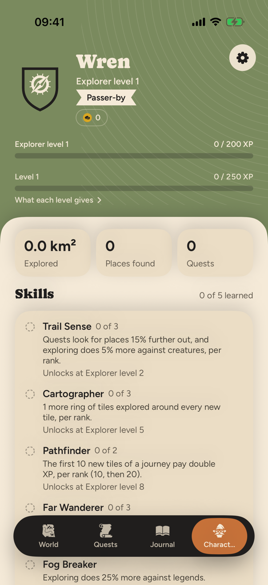 | 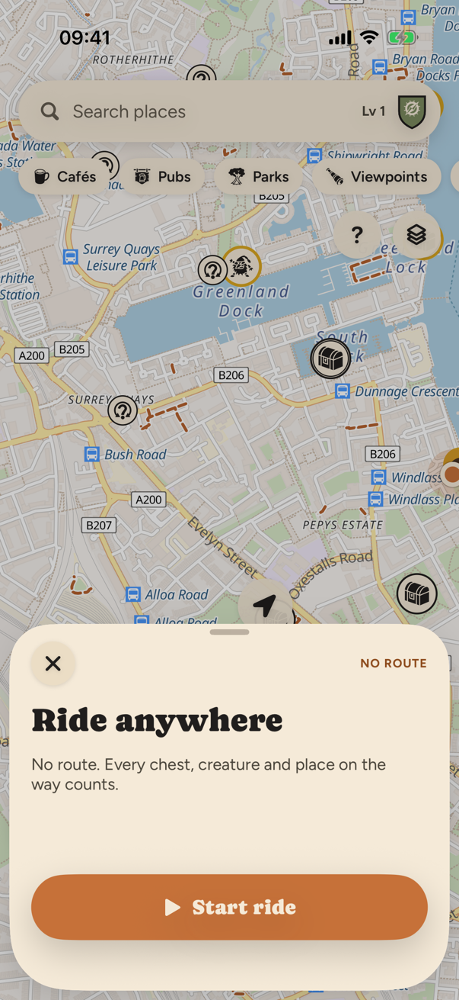 | 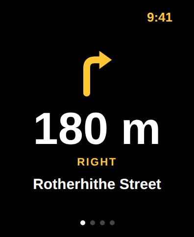 | 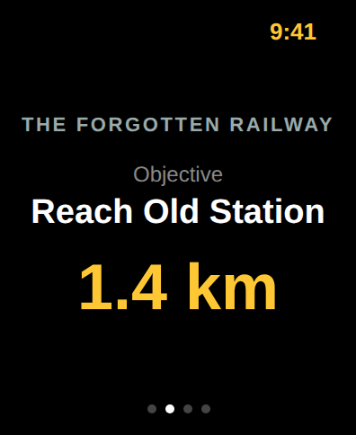 |

The Watch screens are still renders of the design, not captures. The UI
follows the Claude Design project *Cycling Companion* (`docs/design/`): cream
ground, terracotta for the route and the primary action, sage for the rider and
success, class hues for emblems and markers only, Caprasimo for titles and
Figtree for numbers. [docs/SCREENS.md](docs/SCREENS.md) has every screen with
the design option it implements, and the design renders beside them.

## Documentation

| | |
|---|---|
| [PRODUCT_SPEC.md](docs/PRODUCT_SPEC.md) | What the product is, section by section (the `§` numbers elsewhere point here) |
| [ROADMAP.md](docs/ROADMAP.md) | The road to 1.0: every release, what is built and what is still to ride |
| [ARCHITECTURE.md](docs/ARCHITECTURE.md) | How the backend, phone and Watch fit together |
| [API.md](docs/API.md) | The HTTP contract |
| [WORLD.md](docs/WORLD.md) | The Old Roads: premise, trades, cast, lexicon, runes |
| [VOICE.md](docs/VOICE.md) | How the app talks, the glossary, and the checks every line passes |
| [QUEST_SYSTEM.md](docs/QUEST_SYSTEM.md) | Templates, generation, the board, story arcs |
| [COMBAT.md](docs/COMBAT.md) | Fights: effort is damage, runes inscribed, the way back |
| [EXPLORATION.md](docs/EXPLORATION.md) | H3 fog, cells and what counts as new ground |
| [ROUTING.md](docs/ROUTING.md) | GraphHopper and Valhalla, how cards differ, loops that come home |
| [WATCH.md](docs/WATCH.md) | The Apple Watch app |
| [GARMIN.md](docs/GARMIN.md) | Routes on a Garmin, journeys into Garmin Connect |
| [PRIVACY.md](docs/PRIVACY.md) | What is stored, what is shared, what never leaves |
| [FIELD_TESTS.md](docs/FIELD_TESTS.md) | One ride per question: the protocols a release is ridden against |
| [SCREENS.md](docs/SCREENS.md) | Every screen, the design option behind it, and what a ride says |

Elsewhere: `infra/README.md` (the Fly apps and environments), `routing/README.md`
(GraphHopper and the bike models), `ios/README.md` (signing, TestFlight, UI
tests).

## Repository

```
backend/   FastAPI modular monolith (auth, characters, progression, quests,
           routing, exploration, rides, discoveries, social, integrations,
           admin)
ios/       Xcode project (XcodeGen): iPhone app, Watch app, widgets, and the
           pure-Swift RoadsAndRunesCore package
docs/      product spec, roadmap, architecture, API, subsystem docs, the
           Claude Design export (docs/design) and the screens
routing/   GraphHopper configuration and bike custom models
infra/     docker-compose, Fly apps, environment matrix, OSM download script
```

## Quick start

```bash
make up                       # PostGIS + Redis
cp backend/.env.example backend/.env
cd backend && python3.11 -m venv .venv && . .venv/bin/activate && pip install -e ".[dev]"
alembic upgrade head && uvicorn app.main:app --reload
```

The API is at http://localhost:8000/docs. `POST /api/v1/auth/dev` signs in
without Apple credentials in development. A hosted development backend runs on
Fly at https://roadsandrunes.fly.dev (two apps, `infra/README.md`); Release
builds of the app point at it, and a push to `master` that touches `backend/`
deploys it. Routing and quests work anywhere (Valhalla, and places imported
from OpenStreetMap on first use); `make osm && make routing` adds GraphHopper
with the custom bike models for Greater London (`routing/README.md`).
`/admin` shows how the game is being played and switches feature flags without
a deploy; it is off (404) unless `ADMIN_TOKEN` is set.

iOS:

```bash
brew install xcodegen
cd ios && xcodegen generate && open RoadsAndRunes.xcodeproj
```

Set `API_BASE_URL` in `ios/RoadsAndRunes/App/Config.swift` (or the Info.plist
key) to your machine's address when running on a device.

## QA builds

Debug and TestFlight builds show which build they are, one long press on the
Home Screen icon away: the version, the build number TestFlight shows, the
server the build talks to and the app's size on the device.

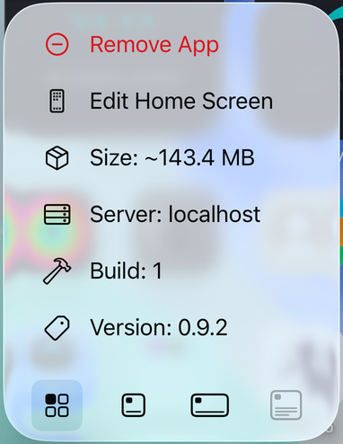

That is [Snitch](https://github.com/onl1ner/Snitch) (MIT, pinned at 1.0.0),
filled at launch and each time the app goes to the background
(`ios/RoadsAndRunes/Services/QA/QAQuickActions.swift`). When reporting a bug,
say what the menu says. `QA_QUICK_ACTIONS` in `ios/project.yml` turns it on;
every Release build goes to TestFlight today, so it is on in both
configurations, and an App Store build sets it to `NO`.

## Tests

```bash
make test                     # backend unit + API tests (SQLite, synthetic router)
cd backend && pytest -m integration   # against PostGIS (CI does this)
cd ios/Packages/RoadsAndRunesCore && swift test
make ios-ui-test              # main-flow UI tests on the simulator; needs `make api`
```

`backend/tests/test_first_playable_journey.py` drives the spec's first
playable journey (sign in → character → quests → route → ride → XP → journal)
end to end.

## Status

0.9.2 is on TestFlight (build 20261015.1241) and on Fly. Each release is
planned in [docs/ROADMAP.md](docs/ROADMAP.md) and gated by a ride from
[docs/FIELD_TESTS.md](docs/FIELD_TESTS.md); most of what is still open is
riding, not building.

| Release | What it brought |
|---|---|
| 0.5 | Rides that talk: chimes, voice, the Watch and the screen from one stream of ride events |
| 0.6.0 Words and faces | A world with its people and bestiary, and a woodcut art system drawn in SwiftUI |
| 0.6.1 Hold | Fights: every creature has a hold, and effort near it loosens it (`effort_combat`) |
| 0.6.2 The Board | Titles, working abilities, story arcs and Act I |
| 0.7.0 Runes and the fog | Runes held, ranked and inscribed, deeds, rune rides, the ink fog |
| 0.7.1 Plain sight | One icon set, the wording pass, how to play, Next up, the map legend |
| 0.7.2 What you carry | Gear in five slots, drops, the stall, coins, something at every level; the Watch catches up |
| 0.7.3 Between rides | Live Activity, widgets, Siri and Action Button quick starts, letters to yourself, the share card |
| 0.8.0 The old ones | Five legends fought over several outings, lairs, treasure maps, Act III |
| 0.9.0 The parish | Districts from OpenStreetMap, the Atlas, festivals, Act IV |
| 0.9.1 Garmin | Send a route to a Garmin and save a journey for Garmin Connect as a FIT file |
| 0.9.2 Ride anywhere | A journey with no route, "to X and back" as a real loop, route cards that differ, `/admin` |
| 1.0 The long way round | Next |

TestFlight builds still leave out the widgets, the Live Activity and the
Watch complication until their App IDs carry the app group (`ios/README.md`).

Verification: the backend suite (unit + HTTP end-to-end) passes on SQLite and,
in CI, against PostGIS after the Alembic migration; the `RoadsAndRunesCore`
Swift package builds and its tests pass on macOS in CI; the iPhone app and its
embedded Watch app compile in CI (unsigned simulator build) and ship to
TestFlight from the `testflight` workflow or `make ios-testflight`.
