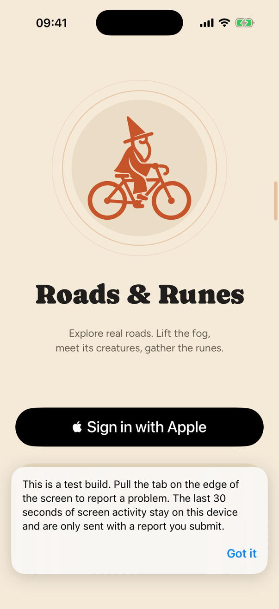
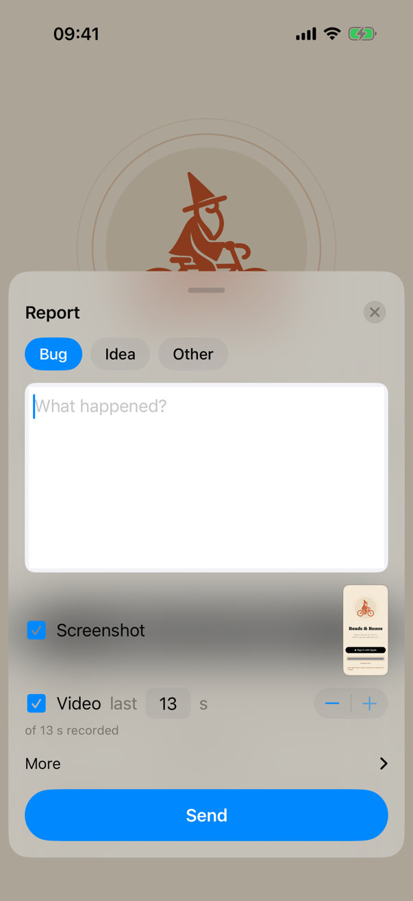

# QA: reporting a problem from the app

Debug, ad hoc and TestFlight builds carry [Snitch](https://github.com/monjar/mobile-app-qa-sdk)
(0.6.0), the same reporter Mochiro uses. A tester pulls the terracotta tab on the right edge of the
screen to the left, picks **Bug**, **Idea** or **Other**, says what happened and taps **Send**.

| The tab, and the card a new install shows once | The report sheet |
|---|---|
|  |  |

## What a report carries

- The screen as it was, which the tester can mark up or blur before sending.
- Up to the last 30 seconds of screen video, if the tester leaves it ticked. Frames are kept in memory
  only and leave the phone only with a report.
- A timeline of the last minutes: launch, foreground and background, touches, the app's log lines, the
  screens, and a summary of each API call (method, path, status, timing; never headers, bodies or query
  values, so no tokens and no coordinates).
- The app version and build, the device, the release type, and `server`: the backend the build talks to.
- After an unexpected exit, the next launch offers to report it with the crash diagnostic.

Text fields are masked in the screenshot and the video. Anything else that should never be seen can be
masked with `Snitch.mask(view)` or an `accessibilityIdentifier` starting with `snitch-mask`.

## Where reports go

To the **Roads & Runes** project (slug `roads-and-runes`, tickets `RR-1`, `RR-2`, …) on the Snitch server
at https://mochiro-snitch.fly.dev, which Mochiro's project shares. The dashboard is at the same address.
There, under the project's settings:

- **Accepted app ids**: `com.roadsandrunes.app`, so the key files reports for this app only.
- **Integrations** and **Routing**, to turn bugs into GitHub issues on `monjar/Roads-Runes` or to send
  them on by email or Slack. That repository is public, so don't let the media go into it or out as
  public links: screens show where riders are. Under *Keep them in another repository*, point the
  screenshots and video at a private repository the fine-grained token can also write to (*Issues:
  write* on Roads-Runes, *Contents: write* on the media repository).

Reports can also be read, video frames included, from the terminal or a coding agent:
`npx snitch-cli login --server https://mochiro-snitch.fly.dev`, then `npx snitch-cli skill install` and
`claude mcp add snitch -- npx -y snitch-cli mcp`.

## When Snitch runs

Snitch decides at run time from how the build was signed: on for `debug` (the simulator, Xcode),
`adhoc` and `testflight`; off for `appstore`, where it adds no tab, captures nothing and makes no
request, even though the TestFlight binary is the one that would ship. It is also off under UI tests
(`RR_UI_TEST=1`), unit tests and previews (`Services/QA/QAReporting.swift`), so the tab and the
one-time card never sit in a test's way. The Watch has no reporter.

## Settings and the key

The settings are the `Snitch` dictionary in `ios/project.yml` (gesture, colour, capture mode, masking,
network summaries, crash prompt), written into the app's Info.plist by XcodeGen.

The ingest key is not in git. `ios/Config/Snitch.xcconfig` includes `secrets/Snitch.xcconfig`, which
holds one line, `SNITCH_INGEST_KEY = snitch_pk_…`. Without that file the key is empty and Snitch stays
inert with one warning in the log, which is what CI and a fresh clone get. A TestFlight build has to be
made where the file is (this Mac), or with the key passed on the command line
(`SNITCH_INGEST_KEY=snitch_pk_…`). The key ships inside the app and can only file reports into this one
project; if it is ever misused, rotate it in the dashboard (`snitch key:create --project roads-and-runes`
on the server) and update the file.

## Taking it out

Remove the `mobile-app-qa-sdk` package and its dependency from `ios/project.yml`, the `Snitch`
dictionary, `ios/Config/Snitch.xcconfig` and `Services/QA/`. Nothing stays on a phone beyond pending
reports in Application Support.
