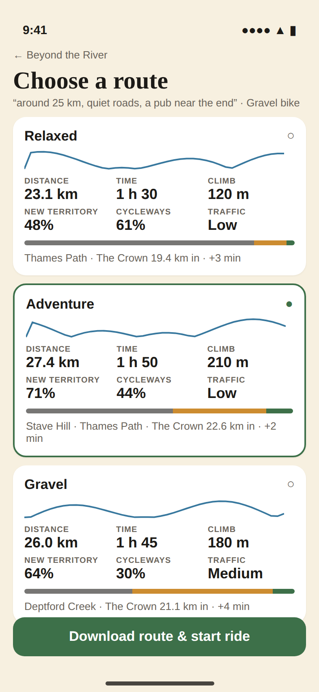
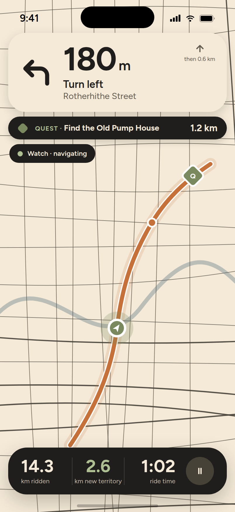

# Routing

| Route alternatives | Navigation |
|---|---|
|  |  |

## Pipeline

```
RouteGenerateRequest                                  (one plan, one budget of 10 engine requests)
  ├─ rider profile + bike → base RoutePreferences
  ├─ free text → parse_request (Claude) → preferences, places, stops
  ├─ places → geocode: origin, destination, via, area
  ├─ stops → picked from the places imported from OpenStreetMap
  ├─ quest → target points, RETURN_TO_START, heading
  └─ cards (up to 3), each from the first of its candidates that is a different ride:
        candidate → engine request (no details) → checks (offset point reached,
        way back not the way out) → kept unless too like a kept card
     then, for kept cards only: surface/road-class details
        → analysis (elevation, climbs, surface, cycleway, traffic)
        → new-territory fraction (H3 vs user's cells, each tile once)
        → quest objective coverage → POI corridor search
        → score → Route row
sorted by score; best becomes quest.suggested_route_id
```

Labels are never "Route 1/2/3", and never a promise the route does not keep.
The planner asks the engine for presets (Relaxed, Adventure, Scenic, Direct,
Gravel, Challenge, Parks, Longer; per bike type or activity, adjusted when the
request asks for gravel, hills or a destination), but a preset names the
request, not what came back: a gravel costing over London's tarmac returns
tarmac. So once the cards are measured, a card still wearing a preset is
renamed for what sets it apart from the other cards, by a margin a rider would
notice (`EARNED` in `app/routing/service.py`):

| Name | True of the card when |
|---|---|
| Most gravel | at least 10% unpaved, and 5 points more than every other card |
| Hilliest / Flattest | 20% and 25 m more / 20% and 15 m less climbing than every other card |
| Quietest | traffic exposure 0.05 under every other card |
| Most cycleways | at least 20% cycleway, and 5 points more than every other card |
| Most new ground | at least 10% new to the rider, and 10 points more than every other card |
| Shortest / The long way | 5% shorter / 10% longer than every other card |

The preset's own aim is tried first (Gravel → Most gravel, Relaxed → Quietest).
The surface names need the engine's surface details on every card; without
them those figures are defaults. A card that earns none is named for the side
it keeps to ("Via the north": for a loop, where it goes from home; for a ride
somewhere, the side of the straight line it bows to), else Another way. One
card alone is The way there or Round trip.

Some names are kept because they are true by construction or checked: As asked;
Other stops; More gravel, Quieter and the rest of a stated preference pushed
further (checked against As asked, `CLAIMS`); Direct on a ride to a place while
no card is more than 3% shorter (the phone prices the other cards against it);
The long way while it is 5% longer than every other card. Direct on a loop
goes nowhere directly and is renamed like a preset, usually Shortest. A note
about a preset card that was dropped would name a card the rider never sees,
so it becomes "only two different ways here". No label appears twice.

A quest's route, a rune ride and a sealed quest go through their own points
(objectives, a rune's shape, a goal) and keep 0.9.1's way of planning: one
request per label, a path that comes back twice is one card. So does a plain
round trip, whose seeds already turn and flip each card.

## Reading a request

A rider types one sentence. Claude reads it — there is no keyword parser behind
it any more. There used to be: word lists for every way of saying "pub", a regex
per preposition, a table of number words, and a rule that whatever was left of
the sentence might be a place. It answered the phrasings someone had thought of
and nothing else, and "quiet roads" planned a ride in Roads Wood.

`app/routing/preferences.py` holds the prompt and a JSON Schema the API
enforces (`output_config.format`, falling back to describing the schema in the
prompt where that parameter is not taken). Every field comes back null when the
sentence did not say it, so the rider's own profile stands.

The sentence can name a place in one of three ways, and they plan different rides:

| They wrote | Reads as | The ride |
|---|---|---|
| "a loop **in** Notting Hill with 5 pubs" | `area` | Moves there, wanders around it, comes home |
| "go **to** the Aragon Tower, 2 pubs on the way" | `destination` | Starts where they are, finishes at the tower |
| "visit **the Moby Dick** then to Aragon Tower" | `via` | Passes through that pub on the way to the tower |
| "**from Aragon Tower** to Westminster and back" | `origin` | Starts at the tower (0.9.2), if that is not where the rider is |

`via` and `stops` look alike in a sentence and are not the same promise. **A name
is the whole test**: "2 pubs on the way" names no pub, so the router picks
whichever two suit the line (`stops`); "the Moby Dick" is one pub and no other
will do, so it is a waypoint (`via`). Read the wrong way round, a rider asking
for their local gets a ride past a stranger's — which is what it used to do,
because the name was dropped and only "1 pub" survived.

**The model returns names, never coordinates.** `app/routing/geocode.py` resolves
them, so nothing it invents reaches navigation (spec §20, §31). The two resolve
differently, because a wrong answer costs differently:

* `area` searches Photon and Nominatim for ground — `place`, `boundary`,
  `leisure`, `natural`, `landuse`, `tourism`. The whole ride moves there, so a
  shop matching the phrase would waste the ride.
* `destination` and each `via` (`kind="point"`) accept nearly anything named: a
  building, a tower, a bridge, a pub, a station. The guard is the name instead —
  the answer has to be called what the rider called it, or a point search will
  happily return a bakery for "the way home".

A destination that resolves becomes a real waypoint: `loop` defaults off, the
stops are picked from the corridor along the way (`_pick_stops_between`, in the
order they are reached) rather than rung around the origin, and the target
distance comes from the trip rather than the app's slider. One that does not
resolve is said out loud in `parsedRequest.notes` — riding somewhere else
quietly is the worse answer.

Each `via` that resolves goes on the line in the order the rider said it, before
the finish, and the trip's own length is measured **through** them: a pub two
kilometres off the direct line makes the ride longer, and scoring it against the
straight distance marks the only route that does what was asked for as too long.
One that does not resolve is named in the notes as well, and the rest of the ride
is planned without it.

`origin` (0.9.2) is resolved like a destination. More than 300 m from the rider
it becomes the start (`parsedRequest.startsAt`); nearer, it is only said back
("from Aragon Tower"). A stop kind with no number ("checking out some pubs")
used to pick none at all: it now means three on a loop and two one way, marked
`poi.countImplied` so that finding two of three is not called a shortfall.

Everything the model returns is range-checked in `parse_request`: a category
nobody imports, a 900 km "ride", a null where a float was expected. A bad answer
narrows to a plain ride, never a wrong one.

### No provider, no reader

`LLM_PROVIDER=anthropic` is the default, but with no `ANTHROPIC_API_KEY` there is
nothing to read a typed request. The planner says so
(`parsedRequest.notes`) and plans from the rider's profile. It does not guess.

### Testing it

Two different questions, tested in two places:

* What the planner *does* with a reading — `tests/test_route_requests.py` and
  `tests/test_llm_parse.py`, against a scripted model (`SCRIPT` in
  `tests/conftest.py`). No network, no spend.
* Whether the model reads a sentence *correctly* — `tests/test_request_reading.py`,
  against the real API, skipped unless `ANTHROPIC_API_KEY` is set:

  ```bash
  ANTHROPIC_API_KEY=sk-... pytest tests/test_request_reading.py
  ```

  A failure there means the prompt needs the case, not that a word list needs
  another word.

## Cards that differ (0.9.2)

Riding 0.9.1 on the hosted backend, the three cards were about 99% the same
road: every card went through the same points and only the costing changed, and
on Valhalla the costings barely differ. Now each card is a **shape** with
fallbacks (`_*_slots` in `service.py`, thresholds in `shapes.py`), behind the
`route_shapes` flag (on; `FEATURE_FLAGS=!route_shapes` plans as 0.9.1 did):

| The plan | Card 1 | Card 2 (Direct) | Card 3: first that differs, else dropped |
|---|---|---|---|
| A place tapped on the map, nothing typed | the quietest flavour, `[O, D]`, asking for 2 alternates | Direct, `[O, D]`, 1 alternate | the alternate least like cards 1–2 (no request) |
| A ride to a place, typed | As asked | `[O, via, D]`, asking for 2 alternates | through a point 0.2× the distance off the far side of card 1's line → a spare alternate (free) → the stops on the other side of the line ("Other stops") |
| A loop through stops | As asked | through half of the stops, at least two, the shortest set that opens out 45–150° from the start (a round trip under three) | "Other stops": none of card 1's, each at least a quarter sector from them → the third costing through the same stops |
| To a place and back | As asked (see Loops) | the cheapest loop: no stops, offset point at 0.2× | "Other stops" on swapped sides (when stops were asked) → "The long way": the offset point mirrored at 0.35× |
| A quest with somewhere to go, a sealed quest | as To a place and back, turning at the furthest objective (see Quests) | | |
| A plain round trip, a quest with nowhere to go, a rune | unchanged | | |

Direct's costing is wider: traffic aversion at most 0.4 and cycleway preference at
most 0.3, which lifts Valhalla's `use_roads` from about 0.44 to 0.6. As asked also
sets `use_living_streets`. Both are another knob between the two cards.

**Alike is measured on shared distance** (`overlap.py`): both lines resampled
every 25 m, a sample within 30 m of the other line counts as shared (London's
parallel streets are 60–100 m apart), 200 m at the shared ends left out, and the
similarity is the smaller of the two shares. A candidate at 0.75 or more to a
kept card is the same ride: the next candidate is tried, and if none is left the
card is dropped. Direct is the yardstick the phone prices the others against, so
it goes only at 0.90 and within 5% of the length ("the stops add only 300 m").
The planner shows fewer cards rather than the same one twice, says why in
`parsedRequest.notes`, and the phone's heading counts what came back: "One way
to ride it", "Two ways…", "Three ways…".

Every card is asked for without the surface details; only the cards kept get
them (one `trace_attributes` each on Valhalla). A card dropped as a duplicate
costs one request, not two.

## Loops to a place (0.9.2)

"To Westminster and back" used to be one request `[O, D, O]`: nothing stopped
the way back retracing the way out, and every stop sat on the way out. Now:

* **Stops split by side** of the O→D line (`_pick_stops_loop`): ⌈N/2⌉ on the way
  out, on the side with more to choose from, in the order reached; ⌊N/2⌋ on the
  way back, on the other side, in the order reached coming home. Stops about
  0.15× the straight distance off the line (400–1,500 m) are preferred.
* **No U-turn at the destination**: it is `break_through`. A way back with no
  stops goes through an **offset point**, 0.30× the straight distance (600 m–4 km)
  off the middle of the line, moved onto the nearest place within 400 m (not a
  park or a trail) and sent as `through` with a 400 m `search_cutoff`.
  `[O(break), out-stops(via), named places(via), D(break_through), R(through)?, back-stops(via), O(break)]`.
* **Checks on the answer**, each giving ground once:
  * no path through `break_through`/`through` (a dead end): asked again as
    `break`/`via`;
  * the offset point missed (the way back passes further than 120 m from it, or
    rides more than 1.6× the straight line through it — across the river, round
    a park): tried mirrored, or nearer the line (0.6×) when the far side has the
    way out's stops or the card's point is its own side, then left out;
  * the way back still rides more than 25% of the way out (`self_overlap`, 250 m
    left out at each end and at the turn): the way back is asked for alone, kept
    off up to 25 points along the middle 60% of the way out (every 300 m, clear of
    the ends, the stops and every junction where the rider turns), and joined to
    it (`join_routes`). An offset point within 300 m of the way out is left out of
    that try: through it, the way back must meet the way out. If the joined loop
    is no better, the first stands and the note says "the way back shares some
    roads with the way out". On Valhalla each point closes every edge within 20 m
    (`radius`), so the carriageway beside a closed cycle track is closed too.
* **The target** is the loop's own polygon × 1.2, not 2.4× the crow's flight.
* **Scoring** subtracts `retracePenalty` (weight 0.8, `config/scoring.json`) times
  the loop's `selfOverlap`, which every loop card carries.

The bar was 40% until 2026-10-19. It let through loops whose whole length was
more than half one road ridden twice: a quarter of the way home already reads as
a line on the map.

## Quests and loops through stops (2026-10-19)

"All of the loops still look like a line." 0.9.2 shaped the planner's loops,
but a quest kept its points: `[O, T, O]`, with a U-turn allowed at the objective.
On public Valhalla, three of a board's six routes from Aragon Tower rode 87–94%
of their length twice (the Green Hour, whose way home says "Come back the way you
did not go"). A sealed quest went `[O, goal, O]` the same way.

* **A quest with somewhere to go** (`_quest_loop_shape`) is a loop to a place:
  it turns at the objective furthest from the start (`break_through`). The other
  objectives go out on the side of the line with more of them and come home on
  the other (`LoopShape.via` / `back_via`, places every card keeps, where a card
  may swap stops). A way home with no objective of its own goes through an offset
  point sized to the quest's distance (`shapes.offset_factor_for`: the polygon
  O→T→R→O × 1.2 is the target, never under 0.30×, at most 4 km off). The checks
  above apply. A quest with nowhere to go (new roads, a distance) is still the
  circle; a rune keeps its points.
* **A sealed quest** asks for its goal as the loop's `destination`, not a
  waypoint, so it is a loop to a place.
* **A loop through stops** has no single turn, so `self_overlap` sees only part of
  a road ridden twice. A card that rides more than 40% of itself twice
  (`overlap.ridden_twice`: within 30 m of another stretch at least 500 m away
  along the route, 250 m at each end left out), or 25% of its way home on its way
  out, gets its way home asked for again. The request starts at the stop nearest
  where it turns and keeps off the way out, as above. The joined loop stands only
  if it rides less of itself twice. Its shorter card (`_round_stops`) takes stops
  that open 45–150° from the start, ordered round the compass, instead of the
  nearest few. The nearest two pubs from Rotherhithe sat either side of it, and
  that card rode out to one, back through home to the other, and home again.

Measured on public Valhalla the same day, as the share of each route ridden twice:

| | Before | After |
|---|---|---|
| Quest board from Aragon Tower (six quests) | 87–94% for quests to a place | 5–25% |
| Sealed quest, 40 / 90 min | there and back | 11% / 2% |
| "A 15 km loop through 3 pubs", Shortest | 63% | 1% (one more request) |
| "Aragon Tower to Westminster and back", Direct / As asked | 33% / 30% | 18% / 12% (two more requests) |

What is left is the ground: the first few hundred metres from a start with one
road out, and the 20-minute sealed goal up the Rotherhithe peninsula, where the
Thames leaves one corridor in (69% after every retry).

## A quest's ways (2026-10-19)

`generate(..., way=)` plans one of a quest's ways (`shapes.WAYS`) for
`quest_ways.py`, one card each, at most 5 requests each (`calls`), behind any
rider waiting on the planner (`budget.background`):

* `ONE_WAY`: `loop=False` and the objectives sorted nearest first, so the ride
  ends at the furthest. The target is the straight lines through them × 1.25.
* `QUIET`: traffic aversion raised to at least 0.95 and cycleways to 0.9.
* `LONG_WAY`: the quest loop's offset point on the other side, sized for 1.5×
  the loop's length and at least 0.5× the line (`_way_shape`). A circle quest
  asks for a circle 1.5× as long.
* `NEW_GROUND`: of the offset points on both sides at 0.30× and 0.5×, the one
  whose polygon crosses the most cells never visited, judged by straight lines
  every 200 m (`_unknown_share`). A circle quest sets off on the heading whose
  circle crosses the most (`_newest_heading`, every 45°).

A loop whose way home passes objectives of its own has no offset point to move.
Its long way and new ground usually come back as the loop, and are left out.

## Engine

The hosted backend routes on the public Valhalla server (`ROUTING_ENGINE=valhalla`,
valhalla1.openstreetmap.de, about one request a second under its fair use);
GraphHopper, with the project's custom bike models, serves the London extract
locally (`ROUTING_ENGINE=auto` sends rides inside its graph to it).

`ValhallaClient` posts `/route` with per-point location types (`break`, `via`,
`through`, `break_through`), `exclude_locations` (each with a 20 m `radius`), a
per-point `search_cutoff`, and `alternates` on a two-point request; it reports
where each leg ends (`EngineRoute.leg_boundaries`). Loops with no destination go
through three points on a circle, rescaled once toward the target while the
budget allows. Surface, road class and cycle network come from a separate
`trace_attributes` call (`details()`), translated into GraphHopper's detail format.

`GraphHopperClient` posts to `/route` with `ch.disable=true`, a custom model,
elevation and details. Loops use `round_trip` with a user/origin-derived seed
per label; with a quest destination the loop is headed towards it and the
target is inserted as a via-point. Two points with alternatives use
`alternative_route`; any `through` point sets `pass_through`; points to avoid
become small low-priority `areas` in the custom model.

`SyntheticRouter` produces plausible loops for tests and for development when
no engine is reachable. Its legs bend the same way there and back, so "to the
tower and back" on it rides one line twice, as a real engine does on a straight
road; it honours points to avoid (bending the other way) and reports leg
boundaries, so the tests can show the fix. Routes carry `engine`; production
refuses to boot on the synthetic engine and clients should treat
`engine == "synthetic"` as non-navigable.

### Pace and budget

* **Pacer** (`valhalla.Pacer`): every Valhalla request, retries included, waits
  its turn behind one lock, at least `VALHALLA_MIN_INTERVAL_S` apart (1 s; 0 in
  tests). A 429 rests the server for everyone for max(Retry-After, 2 s). A rider
  waiting on the planner goes ahead of the quest board's prefetch
  (`budget.background()`), which routes at most two quests, without details,
  while `ROUTING_ENGINE=valhalla`. One machine, one lock: a second Fly machine
  would need a shared limiter.
* **Budget** (`budget.py`): each plan may make 10 requests, charged per HTTP
  attempt. The first card is never refused; every other candidate, fallback and
  second attempt checks what is left, keeping one request for each kept card's
  details. The five test plans cost 4, 6, 6, 6 and 10; `engine_calls` is on the `route_generated` log
  line.
* **Details retry**: `trace_attributes` is retried while the budget lasts. A card
  whose details never came carries `detailsMissing`, so its default surface and
  traffic are not shown as measured.

### Measuring it on the real engine

`backend/scripts/route_diversity.py` plans five London requests in-process
against public Valhalla (paced at 1 request/s, at most 60 per run, answers cached
in `backend/scripts/.route_diversity_cache/`, readings scripted and place names
fixed, so two runs differ only in the routing) and prints each card's length,
how much of a loop's way back rides its way out, the similarity of every pair
and the requests used. `--flags '!route_shapes'` plans as 0.9.1 did;
`--offline` replays the cache without sending anything.

On 2026-10-11:

| | 0.9.1 | 0.9.2 |
|---|---|---|
| Cards from the five requests | 10 | 14 |
| Mean / max similarity between cards | 0.75 / 1.00 | 0.38 / 0.70 |
| Mean / max way back on way out (loops) | 0.39 / 0.68 | 0.28 / 0.59 |
| "Some pubs" | no pubs | 3 pubs, split by side |
| Engine requests | 30 | 32 |

Rotherhithe → Greenwich and back is still the hard one: its As asked loop rode
59% of its way out (the second try met the carriageway beside the cycle track it
had closed; the 20 m exclusion radius came after that run and is not yet
measured).

## Custom models

Base profiles (`routing/custom_models/*.json`) encode bike capability and
block motorway/trunk. `app/routing/custom_models.py` turns preferences into a
request-time overlay: traffic aversion penalises primary/secondary/tertiary,
cycleway preference lowers everything that is not cycling infrastructure,
gravel preference and bike capability adjust unpaved surfaces and tracks, low
hill tolerance penalises `average_slope >= 6`, scenic preference favours
non-road environments. Overlays multiply priorities and can only reduce them
for unsafe classes.

## Analysis

* Elevation samples every 100 m from the returned 3D coordinates; smoothing
  window 3; ascent/descent with 3 m hysteresis; max gradient over samples;
  climbs = rising stretches ≥ 30 m gain and ≥ 2 %, ended by a 15 m drop;
  longest climb and average climb gradient.
* Surface composition from `details.surface` buckets (paved, gravel, trail,
  unknown), cycleway fraction from `road_class == cycleway` or bike network,
  traffic exposure = length-weighted road-class score.

## Scoring

```
score = ( w1·preferenceFit + w2·questFit + w3·exploration + w4·poi + w5·scenic
        − w6·traffic − w7·difficulty − w8·surfaceMismatch ) / Σ positive weights
```

Weights in `backend/app/routing/config/scoring.json`. Difficulty penalty
compares distance, climbing and max gradient against the rider profile (never
the RPG level). Surface mismatch penalises gravel/trail on bikes that do not
allow them.

## POIs

Candidates come from `discoveries` within 60 % of the target distance
(PostGIS `ST_DWithin`); `attach_pois` keeps those within a 400 m corridor and
computes route position, detour distance/time, ETA and relevance (boosted for
the requested category near the requested position). Output: "The Crown ·
24.6 km into ride · +600 m · +3 min".

## Route package

`GET /routes/{id}/package` bundles route geometry, instructions, elevation,
climbs, POIs, the quest and a map region for offline use. The client stores
it before starting and navigates from it without network.

## Rerouting

The client detects off-route (> 40 m cross-track for 3 fixes) and from then on
shows the way back itself: which way and how far the nearest of the remaining
route is, drawn as a dashed line. That needs no network.

After 8 s off route, or at once when more than 150 m off, it asks
`POST /routes/{id}/reroute` for a new route from the current position: through
the objectives not yet done and the requested stops not yet reached, to where
the route was going. Requests are at least 15 s apart and back off (30 s, 60 s)
after failures; the rider can ask by hand at any time. The decision is made on
a timer as well as on each fix, since fixes are filtered by distance and a
rider who has stopped sends none.

An answer for somewhere the rider has since left (more than 60 m on, and not on
the new route) is asked for again; one that arrives after they have rejoined the
old route is dropped. Off the route no progress is made along it: the reroute
is told how far they had got when they left. Quest objectives, not the original
polyline, decide completion.

The reroute is one engine request without the surface-details call. Valhalla
requests are retried twice (0.5 s, 1.5 s, or `Retry-After`) on a timeout, a 429
or a 5xx; "no path" is an answer and is not retried. A reroute is outside any
plan's budget but waits its turn at the pacer like every Valhalla request.
